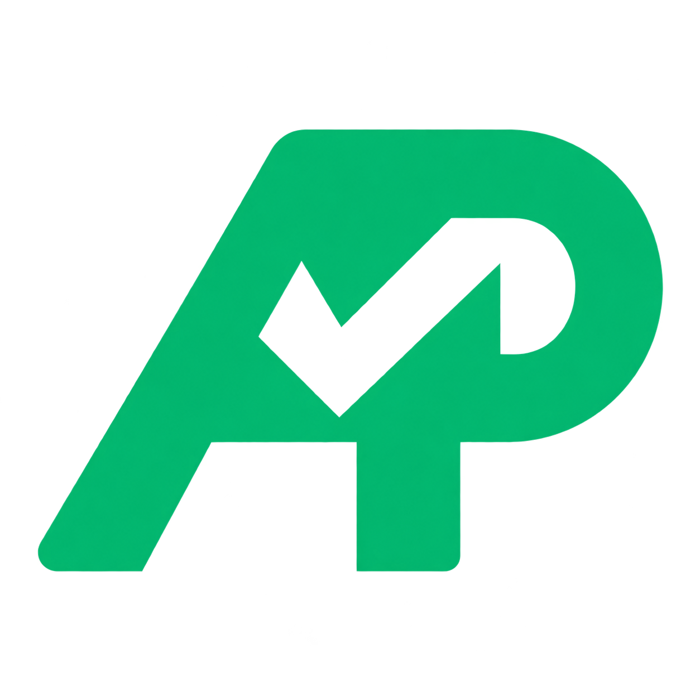

<p align="center">
  
</p>
<h1 align="center">APIProof</h1>
<p align="center"><strong>Don't recommend an API. Prove it fits.</strong></p>
<p align="center">An open Agent Skill for Claude Code, Codex, Cursor, Antigravity and other compatible coding agents.</p>
<p align="center">
  <a href="https://github.com/raskar-pratik/API_Proof/actions/workflows/test.yml"></a>
  
  <a href="LICENSE"></a>
</p>
<p align="center"><a href="#quick-start">Quick start</a> · <a href="#agent-compatibility">Compatibility</a> · <a href="#the-decision">Reports</a> · <a href="#verification">Verification</a></p>

Choosing an API is easy. Finding out that it lacks a required feature, exceeds your budget or needs credentials you cannot supply usually happens later. APIProof brings those checks before integration.

Give your coding agent the project requirements and, optionally, a repository. The skill directs it to inspect provider documentation, collect evidence for each requirement, run a small live probe when possible, and return a decision with its conditions and gaps.

## What you get

- **Project context:** required features and constraints, with must-haves separated from optional features.
- **Traceable evidence:** provider URLs, observation times, excerpts, probe assertions and artifact hashes.
- **A decision you can inspect:** JSON and Markdown reports with one of four verdicts.

Requirements are mandatory. A repository is optional. APIProof is an agent skill plus small Python helpers; it has no hosted service or model-provider dependency.

## Agent compatibility

APIProof is a portable `SKILL.md` bundle. Install the **whole `api-proof/` folder** so relative links to scripts, references and assets keep working.

| Agent | Project installation | Alternative / global location | Use it |
| --- | --- | --- | --- |
| [**Claude Code**](https://code.claude.com/docs/en/skills) | `.claude/skills/api-proof/` | `~/.claude/skills/api-proof/` | `/api-proof`, or ask Claude to use APIProof. |
| [**OpenAI Codex**](https://learn.chatgpt.com/docs/build-skills) | `.agents/skills/api-proof/` | `~/.agents/skills/api-proof/` | Mention `$api-proof`. |
| [**Cursor Agent**](https://cursor.com/docs/skills) | `.agents/skills/api-proof/` | Project: `.cursor/skills/api-proof/`; global: `~/.cursor/skills/api-proof/` | `/api-proof`, or ask Agent to use APIProof. |
| [**Google Antigravity**](https://antigravity.google/docs/skills/) | `.agents/skills/api-proof/` | IDE/app: `~/.gemini/config/skills/api-proof/` | Ask the agent to use APIProof; inspect it in Customizations. |
| [**Gemini CLI**](https://geminicli.com/docs/cli/skills/) | `.agents/skills/api-proof/` | Project: `.gemini/skills/api-proof/`; global: `~/.gemini/skills/api-proof/` | Ask Gemini to use APIProof; check discovery with `/skills list`. |
| [**GitHub Copilot Agent**](https://docs.github.com/en/copilot/how-tos/copilot-on-github/customize-copilot/customize-cloud-agent/add-skills) | `.agents/skills/api-proof/` | Project: `.github/skills/api-proof/`; global: `~/.copilot/skills/api-proof/` | Ask Copilot in agent mode, CLI or cloud agent to use APIProof. |
| [**Windsurf / Devin Desktop**](https://docs.devin.ai/desktop/cascade/skills) | `.agents/skills/api-proof/` | Project: `.devin/skills/api-proof/` or legacy `.windsurf/skills/api-proof/` | Mention `@api-proof` in Cascade. |
| [**OpenCode**](https://opencode.ai/docs/skills/) | `.agents/skills/api-proof/` | Project: `.opencode/skills/api-proof/`; global: `~/.config/opencode/skills/api-proof/` | Ask the agent to load the APIProof skill. |

These clients document support for the bundle format and paths above; sources were checked on 14 October 2026. Execution still depends on the client's available tools and permissions. APIProof's Python helpers and external HTTPS probe have passed GitHub Actions; individual activation tests in each listed client are pending.

For Antigravity, legacy `.agent/skills/` is also supported; its CLI global path is `~/.gemini/antigravity-cli/skills/`. Windsurf/Devin Desktop also supports `~/.codeium/windsurf/skills/` globally. Keep one active copy per client to avoid ambiguous versions.

## Quick start

Run these commands from the root of the project whose APIs you want to evaluate. The shared `.agents/skills/` setup below works with the documented locations for Codex, Cursor, Antigravity, Gemini CLI, Copilot, Windsurf/Devin Desktop and OpenCode. Use the separate Claude Code setup beneath it. Start with a fresh destination folder.

### macOS / Linux / Git Bash

```bash
git clone https://github.com/raskar-pratik/API_Proof.git APIProof-src
mkdir -p .agents/skills
cp -R APIProof-src/api-proof .agents/skills/api-proof
```

### Windows PowerShell

```powershell
git clone https://github.com/raskar-pratik/API_Proof.git APIProof-src
New-Item -ItemType Directory -Force .agents/skills | Out-Null
Copy-Item -Recurse APIProof-src/api-proof .agents/skills/api-proof
```

### Claude Code

After cloning `APIProof-src`, install into Claude Code's project directory.

**macOS / Linux / Git Bash:**

```bash
mkdir -p .claude/skills
cp -R APIProof-src/api-proof .claude/skills/api-proof
```

**Windows PowerShell:**

```powershell
New-Item -ItemType Directory -Force .claude/skills | Out-Null
Copy-Item -Recurse APIProof-src/api-proof .claude/skills/api-proof
```

Then run `/api-proof` in Claude Code. If the skills directory was created during an existing session, use `/reload-skills` or start a new session.

Then open the target project in your agent. If the skill does not appear, start a new agent session or reload its skill list. To upgrade an existing installation, update the existing `api-proof` folder rather than copying a second folder inside it.

Give the agent a concrete task:

```text
Use APIProof to evaluate APIs for a server-side weather dashboard.
Must-haves: current temperature in Celsius, at least 200 requests/day,
and a documented free plan. Historical weather is optional.
Compare the candidates using current provider docs. Run harmless live
checks where access permits. Return the evidence, gaps and final verdict.
```

In Claude Code or Cursor, select `/api-proof`. In Codex, begin the same prompt with `Use $api-proof`. In Cascade, mention `@api-proof`. In the other clients, ask the agent to load and use APIProof.

### Runtime requirements

- **Python 3.10+** for the executable helpers. No third-party Python dependencies.
- **Documentation access** through your agent's browsing or connected tools.
- **Approved outbound HTTPS** for live probes, and provider credentials only when the endpoint needs them.

On Windows, use `py -3` in place of `python` if that is your Python launcher. The skill itself does not require an OpenAI, Anthropic or Google API key; your agent's own account and provider authentication are separate.

## The decision

| Verdict | Meaning |
| --- | --- |
| `fit` | All declared requirements are met with the required evidence; no recorded conditions remain. |
| `fit with conditions` | Must-haves are met, with conditions, documentation-only claims or optional gaps to address. |
| `not fit` | A must-have is disproven. |
| `insufficient evidence` | A must-have is unproven or its evidence conflicts. |

A documentation claim is kept separate from an observed test result. Missing credentials, expired evidence and access failures remain gaps; the agent must not turn them into invented passes.

The agent handles discovery and source interpretation. The verifier checks ledger structure, evidence freshness, conflicts, artifact bindings and verdict aggregation. A passing report covers the **declared requirements and observation window**, not every possible use of a provider.

### What a report looks like

A public repository dashboard might require repository metadata, anonymous reads and a paced request budget.

| Candidate | Verdict | Evidence / condition |
| --- | --- | --- |
| GitHub REST | `fit with conditions` | Repository fields and anonymous reads are documented. The public repository smoke probe passed; pacing and secondary limits still need handling. |
| GitHub GraphQL | `not fit` for a GET-only requirement | Normal repository queries use POST. Change that requirement and reevaluate before rejecting GraphQL for a different project. |

The actual report preserves evidence for every requirement; this table is a compact illustration. Unknown or conflicting must-haves return `insufficient evidence` rather than a guessed recommendation.

## Run the helpers directly

From this repository:

```bash
# Produce report.json and report.md from the bundled synthetic ledger.
python api-proof/scripts/evaluate.py api-proof/assets/ledger.example.json --output-dir output

# Make one bounded request to a public repository endpoint.
python api-proof/scripts/probe.py examples/github-probe.json --allow-host api.github.com --output output/probe.json

# Run the regression suite.
python -m unittest discover -s api-proof/scripts -p 'test_*.py' -v
```

The example ledger is synthetic and its fixed date will eventually expire. Use current sources for actual decisions. See the [evidence contract](api-proof/references/evidence-contract.md) for ledger fields, freshness rules and probe specifications.

## Verification

[Verified GitHub Actions run](https://github.com/raskar-pratik/API_Proof/actions/runs/38541439483):

- **28 regression tests passed:** verdicts, missing/conflicting evidence, freshness, live-proof enforcement, malformed inputs, artifact tampering, path boundaries and probe handling.
- **4 live assertions passed:** HTTP 200, valid JSON, a repository web URL and the expected repository identity, using the standalone HTTPS helper without an authentication header.

The workflow reruns the regression suite on pushes and pull requests; pushes also run the bounded public-endpoint smoke check. One successful probe is not an uptime guarantee or load test.

## Boundaries

HTTP APIs are the MVP scope. The probe helper sends GET/HEAD only, checks an explicit host allowlist and public destination addresses, verifies TLS, follows no redirects and caps response bytes. Authentication header values come from named environment variables and are not written into reports.

A hash binds recorded bytes to a report; it does not authenticate provider truth. Documentation still needs semantic review. A successful response cannot establish future pricing, policy compliance or the identity of a hidden language model. Confirm that the chosen endpoint is harmless: GET does not guarantee no billing or side effects.

## License

[MIT](LICENSE).
